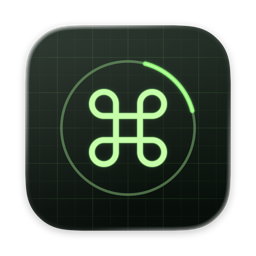
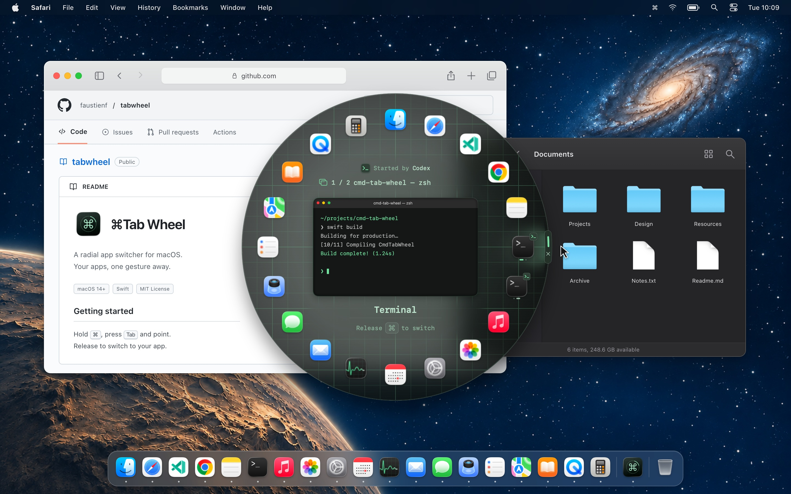

<p align="center">
  
</p>

<h1 align="center">⌘Tab Wheel</h1>

<p align="center">A radial app switcher for macOS: hold ⌘, press Tab, point at an app, let go.</p>

<p align="center">
  
</p>

## Features

- Pick an app by direction; the pointer can be anywhere on screen
- Apps keep their slots, in launch order
- A quick ⌘Tab jumps back to the previous app
- Apps with several windows get a sector per window
- Windows on other desktops and minimized ones are there too
- Window previews, live after a second (Live Preview in the menu bar)
- Close windows and quit apps without leaving the wheel
- Favorite windows: star them on the wheel, ⌘Space shows only them
- Lives in the menu bar; light and dark

## Install

Needs macOS 14 or later. In Terminal:

```bash
curl -fsSL https://raw.githubusercontent.com/faustienf/tabwheel/main/scripts/download.sh | bash
```

It downloads the latest release, puts it in Applications and starts it; run it again to update. On first launch, the setup window asks for **Accessibility** (required) and **Screen Recording** (optional, for previews).

Or download [CmdTabWheel.dmg](https://github.com/faustienf/tabwheel/releases/latest/download/CmdTabWheel.dmg) and drag the app into Applications. It isn't notarized, so macOS won't open it the first time: try to open it, then System Settings → Privacy & Security → **Open Anyway**.

### From source

Needs Xcode 16 or later.

```bash
git clone https://github.com/faustienf/tabwheel.git
cd tabwheel
scripts/setup.sh
```

It asks what to do; the first answer, the default, builds the app, puts it in Applications and starts it. To update, `git pull` and run `scripts/setup.sh` again.

## Keys

| | |
|---|---|
| ⌘Tab | Open the wheel |
| Pointer, Tab, ⇧Tab | Select |
| Release ⌘, or click | Switch |
| ⌘W, or × on the selected sector’s rim | Close the selected window; the app's last one quits the app, and so does ⌘W on an app with no windows |
| ⌘Q | Quit the selected app |
| ★ on the selected sector’s rim | Add the window to favorites, or take it out |
| ⌘Space | Every window ⇄ only favorites; the next ⌘Tab opens the way you left it |
| Esc | Cancel |

## Development

Open `Package.swift` in Xcode and press ⌘R, or run `scripts/setup.sh dev`. Tests: `scripts/setup.sh test`.

To publish a release, push main and run `scripts/setup.sh release`: it tags the commit, and GitHub builds the download and publishes it.

If the app dies without cleaning up and ⌘Tab stops working:

```bash
scripts/setup.sh restore
```

## Something wrong?

Menu bar icon → **Save Log…**, then attach the file to an issue. It has what the app did since launch and its latest crash report: app names and errors, no window titles or keystrokes.

## License

[MIT](LICENSE)
